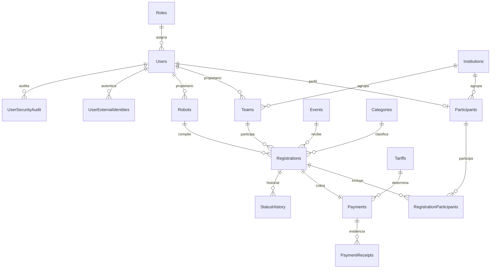

# Documentación completa del backend UTA SUMO ROBOTICS CUP

**Estado:** backend en desarrollo local, rama `feature/backend-core`  
**API:** FastAPI + SQLAlchemy + SQL Server  
**Base local:** `UTA_SUMO_ROBOTICS_CUP` en SQL Server Express  
**Prefijo API:** `/api/v1`  
**Swagger:** `http://127.0.0.1:8000/docs`

Esta guía describe el código, el modelo de datos, las migraciones, seguridad,
roles, endpoints, flujos de inscripción y pago, reportes, paginación, pruebas,
Postman, el acceso del participante y las cuentas privilegiadas. Las contraseñas
y claves reales no se documentan aquí.

## 1. Qué contiene el backend

El backend expone una API JSON para registrar participantes, mantener los
catálogos de la competencia, crear equipos y robots, inscribirlos en eventos,
registrar pagos, recibir y descargar comprobantes, revisar solicitudes y
generar reportes. La API valida permisos por rol y por propietario del recurso.

La aplicación se encuentra en `backend/uta_sumo_api`:

| Ruta | Responsabilidad |
| --- | --- |
| `main.py` | Aplicación FastAPI, routers, CORS, límite de cuerpo para comprobantes y manejo de errores SQL. |
| `database.py` | Motor, cadena de conexión y sesiones SQLAlchemy. |
| `app/core/config.py` | Configuración local y validación de límites. |
| `app/core/security.py` | Hash Argon2id, verificación heredada bcrypt y JWT. |
| `app/core/crypto.py` | Cifrado AES-GCM y búsqueda por HMAC de correo. |
| `app/dependencies/auth.py` | Autenticación Bearer y autorización por rol. |
| `app/services/` | Lógica compartida de autenticación, cifrado y validación de identidad Google. |
| `app/schemas/` | Validación de entradas y salidas con Pydantic. |
| `routers/` | Endpoints HTTP agrupados por función. |
| `scripts/migrate.py` | Aplicación versionada y transaccional de las migraciones. |
| `scripts/provision_operator_user.py` | Alta interactiva de una cuenta privilegiada por operador. |
| `scripts/bootstrap_local_demo_accounts.py` | Datos sintéticos y credenciales locales para pruebas. |
| `tests/` | Pruebas de fundamentos y de integración con SQL Server. |
| `postman/` | Colecciones, entorno local y comprobante sintético. |
| `frontend/uta-sumo-web/` | Acceso React de participantes con registro/correo/Google y login separado para personal autorizado. |

El directorio `database/` contiene los scripts de esquema, restricciones,
índices, seeds y actualizaciones incrementales. `docs/backend/` mantiene la
documentación operativa y de seguridad.

## 2. Arquitectura y relaciones



La base usa claves primarias, foráneas, restricciones `CHECK`, unicidad e
índices. Una inscripción enlaza evento, categoría, equipo y robot; la relación
`RegistrationParticipants` determina las personas y su papel en la inscripción.
Una inscripción crea un pago usando la tarifa vigente. El historial de estados
se conserva en `StatusHistory`; las auditorías de cuentas se guardan en
`UserSecurityAudit`. Los comprobantes binarios cifrados residen en el sistema de
archivos privado; SQL conserva su metadata y clave de almacenamiento.

La cuenta de aplicación se asocia a un perfil `Participants`. Equipos y robots
registran propietario; las consultas de participantes limitan los resultados a
los recursos autorizados. Las filas antiguas sin propietario no se publican a
participantes de forma automática.

## 3. Instalación, configuración y ejecución local

Abre PowerShell en la raíz `ProyectoSumoBox` y ejecuta:

```powershell
cd .\backend\uta_sumo_api
py -3.14 -m venv .venv
.\.venv\Scripts\python.exe -m pip install -r requirements.txt
```

Si el entorno ya existe, no hace falta recrearlo. Copia el `.env.example` de la
raíz a `backend/uta_sumo_api/.env` y configura los valores locales. El `.env`
real debe permanecer ignorado por Git.

| Variable | Propósito |
| --- | --- |
| `DB_SERVER` | Instancia, por ejemplo ` .\\SQLEXPRESS` (sin espacio inicial). |
| `DB_NAME` | Base, localmente `UTA_SUMO_ROBOTICS_CUP`. |
| `DB_DRIVER` | Driver ODBC instalado, normalmente ODBC Driver 18 for SQL Server. |
| `DB_AUTH_MODE` | `windows` para autenticación integrada o `sql` para SQL Login. |
| `DB_USERNAME`, `DB_PASSWORD` | Credenciales SQL solo si `DB_AUTH_MODE=sql`. |
| `DB_TRUST_SERVER_CERTIFICATE` | Aceptación local del certificado SQL; en producción usar certificado y `no`. |
| `SECRET_KEY` | Clave aleatoria de al menos 32 caracteres para firmar JWT. |
| `PII_ENCRYPTION_KEY` | Clave base64url de 32 bytes para cifrado AES-GCM. Debe preservarse y respaldarse de forma segura. |
| `GOOGLE_CLIENT_ID` | ID del cliente OAuth Web; necesario para habilitar los endpoints Google. No es un secreto. |
| `EMAIL_CHECK_DELIVERABILITY` | Activa validación de dominio/DNS/MX; no prueba control del buzón. |
| `AUTO_BOOTSTRAP_DEMO_ACCOUNTS` | Controla la creación de identidades demo locales. Desactivar en producción. |
| `ACCESS_TOKEN_EXPIRE_MINUTES` | Vida de JWT; por defecto 30 minutos, máximo 24 horas. |
| `CORS_ORIGINS` | Orígenes frontend separados por coma; no admite `*` con credenciales. |
| `VITE_API_BASE_URL` | URL base del backend utilizada por la interfaz React. |
| `VITE_GOOGLE_CLIENT_ID` | Client ID público para Google Identity Services en la interfaz. |
| `RECEIPT_STORAGE_DIR` | Directorio privado de comprobantes. Por defecto bajo `storage/receipts`. |
| `MAX_RECEIPT_BYTES` | Tamaño máximo; por defecto 5 MiB y máximo 20 MiB. |

Aplica migraciones y arranca la API desde `backend/uta_sumo_api`:

```powershell
.\.venv\Scripts\python.exe .\scripts\migrate.py
.\.venv\Scripts\python.exe -m uvicorn main:app --reload
```

Prueba `GET http://127.0.0.1:8000/api/v1/health`, consulta Swagger en
`/docs` y OpenAPI en `/openapi.json`. La API local necesita SQL Server activo.

Para iniciar la interfaz, abre otra terminal desde la raíz del repositorio:

```powershell
cd .\frontend\uta-sumo-web
Copy-Item .env.example .env
npm install
npm run dev
```

Configura `VITE_API_BASE_URL` y `VITE_GOOGLE_CLIENT_ID` en el `.env` del
frontend. Reinicia Vite al cambiar variables `VITE_*`.

Las migraciones son aditivas; el modo normal preserva datos existentes. El
ejecutor registra el SHA-256 de cada script y rechaza cambios a migraciones ya
aplicadas. `--reset-local --confirm-drop` es solo para reiniciar explícitamente
la base local: elimina los datos de esa instancia y no se necesita para una
migración normal.

## 4. Modelo SQL y scripts

El esquema inicial y sus evoluciones están ordenados así:

| Archivo | Contenido |
| --- | --- |
| `database/scripts/01_create_database.sql` | Crea la base si no existe. SQL Server ejecuta `CREATE DATABASE` fuera de la transacción de aplicación. |
| `database/scripts/02_create_tables.sql` | Tablas de catálogos, cuentas, participantes, equipos, robots, inscripciones, pagos, evidencias e historial. |
| `database/seeds/02_initial_data.sql` | Roles, estados y datos base de competición. |
| `database/scripts/03_create_relationships.sql` | Relaciones y claves foráneas. |
| `database/scripts/04_create_indexes.sql` | Índices iniciales. |
| `database/scripts/05_create_constraints.sql` | Checks, unicidad y reglas del dominio. |
| `database/scripts/06_email_encryption_upgrade.sql` | Cifrado de datos personales históricos y transformación de identidad. |
| `database/scripts/07_email_encryption_constraints.sql` | Finaliza campos cifrados, HMAC único y validación de hashes. |
| `database/scripts/08_pagination_indexes.sql` | Índices adicionales para filtros/orden de listados y reportes. |
| `database/scripts/09_google_identities.sql` | Tabla única por usuario/proveedor y sujeto OIDC verificado. |

El esquema tiene cuentas, roles, instituciones, categorías, eventos, equipos,
participantes, robots, inscripciones, participantes asociados, tarifas, pagos,
comprobantes, auditoría de cuentas, historial de estado e identidades externas.
La identidad de Google se guarda por su `sub` estable; no se persiste el ID token,
access token ni contraseña de Google.

La tabla de usuarios mantiene un hash de contraseña obligatorio por la
compatibilidad del esquema; para una cuenta exclusivamente Google se genera un
secreto aleatorio que se descarta y solo se almacena su hash Argon2id. Ese valor
no es la contraseña Google y el usuario nunca lo conoce. El acceso solo ocurre
con token Google verificado.

## 5. Registro, autenticación y Google

### Contraseña local

`POST /api/v1/auth/register` valida el correo, el dominio, la contraseña de al
menos 15 caracteres y la institución activa. El cliente no puede asignarse un
rol; el registro público crea solo `PARTICIPANT` y su perfil dentro de una misma
transacción. Las contraseñas se almacenan con Argon2id. Hashes bcrypt antiguos
se comprueban y se actualizan al próximo login. `POST /api/v1/auth/login` recibe
JSON `{ "email": "...", "password": "..." }` y devuelve un JWT Bearer.

### Acceso con Google añadido

Google no entrega al backend la contraseña de la cuenta Google. El frontend
debe mostrar “Continuar con Google” mediante Google Identity Services; Google
autentica a la persona y el cliente envía el **ID token** firmado a la API. La
API comprueba la firma, emisor, expiración, audiencia `GOOGLE_CLIENT_ID` y
`email_verified`, luego crea un JWT propio de la aplicación. El ID token es una
credencial temporal y debe viajar solo por HTTPS en producción.

| Ruta | Requisito | Comportamiento |
| --- | --- | --- |
| `POST /api/v1/auth/google` | JSON con `id_token`; `institution_id` si la cuenta aún no existe. | Crea perfil `PARTICIPANT` la primera vez y autentica en los siguientes accesos. |
| `POST /api/v1/auth/google/link` | JWT existente y JSON con `id_token`. | Vincula el sujeto Google a una cuenta autenticada cuando sus correos coinciden. |

Ejemplo de body inicial:

```json
{
  "id_token": "ID_TOKEN_VIGENTE_DEVUELTO_POR_GOOGLE",
  "institution_id": 1
}
```

La migración 09 ya crea la estructura local. **El acceso Google permanece
deshabilitado hasta definir `GOOGLE_CLIENT_ID` en `.env` y reiniciar la API**; la
API devuelve `503` mientras falte. No se puede completar una autenticación real
desde Postman inventando un token: hace falta que Google emita uno para el mismo
ID de cliente configurado.

Configuración que falta en Google Cloud Console:

1. Crear o seleccionar un proyecto Google Cloud y configurar OAuth consent
   screen/branding y los usuarios de prueba, si la aplicación sigue en modo de
   pruebas.
2. Crear un OAuth Client ID de tipo **Web application**.
3. Añadir el origen del frontend local a **Authorized JavaScript origins**,
   por ejemplo `http://localhost:5173`.
4. Poner el Client ID en la configuración del frontend y en
   `GOOGLE_CLIENT_ID` de `backend/uta_sumo_api/.env`; ambos valores deben
   coincidir. No se requiere Client Secret para el intercambio de ID token que
   implementa este endpoint.
5. Reiniciar FastAPI. En producción usar HTTPS, dominios autorizados, pantalla
   OAuth publicada y política de privacidad/consentimiento completa.

Una cuenta local preexistente con el mismo correo no se vincula silenciosamente:
primero debe iniciar sesión por su método actual y usar `/auth/google/link`.
Esto evita tomar control de cuentas antiguas solo por presentar un email. La
identidad externa se basa en el `sub`, no en el email. Google considera
`email_verified` verdadero para Gmail; para direcciones de terceros puede
indicar que Google la verificó originalmente, no que la persona controle hoy
ese buzón. Se recomienda Google/Gmail o un desafío separado antes de confiar en
dominios externos.

El botón Google y el registro local aparecen en las rutas React `/`,
`/inscripcion` y `/participante`, destinadas exclusivamente a `PARTICIPANT`.
La ruta `/admin` solo ofrece email y contraseña. La API también restringe
`/auth/google` y `/auth/google/link` a participantes; una identidad Google no
puede crear, autenticar ni vincular cuentas `ADMIN`, `REVIEWER` o `TREASURY`.

El personal privilegiado se crea manualmente mediante
`backend/uta_sumo_api/scripts/provision_operator_user.py`. Este aprovisionador
valida correo y dominio, rol permitido, nombre/apellido, confirmación y la misma
política de contraseña del registro de participantes: al menos 15 caracteres,
máximo establecido, rechazo de claves previsibles y prohibición de incluir el
correo. El usuario luego accede manualmente a `/admin` con email y contraseña;
el registro público nunca acepta roles privilegiados.

### Otras rutas de autenticación

`GET /api/v1/auth/me` devuelve la cuenta actual. `POST /api/v1/auth/change-password`
requiere sesión Bearer, contraseña actual y nueva contraseña; incrementa la
versión del token e invalida sesiones previas. No hay refresh token. Las cuentas
privilegiadas se crean por un operador con
`scripts/provision_operator_user.py`; no existe contraseña admin universal ni
rol privilegiado en el registro público.

## 6. Roles y autorización

Todas las rutas privadas usan `Authorization: Bearer <JWT>`. El backend recarga
el rol, estado activo y versión del token desde SQL; desactivar o cambiar el rol
invalida tokens anteriores. La propiedad se verifica además del rol.

| Rol | Capacidades principales |
| --- | --- |
| `PARTICIPANT` | Perfil y recursos propios; equipo/robot; inscripciones propias; comprobante y consulta propia. No accede a finanzas globales. |
| `REVIEWER` | Cola e historial de inscripciones; aprobar, observar o rechazar cuando la transición sea válida; reportes de inscripción. |
| `TREASURY` | Pagos/comprobantes y revisión financiera; reportes agregados/detallados de pagos. |
| `ADMIN` | Catálogos, cuentas, roles, auditoría, dashboard; revisión de inscripción y pagos; todos los reportes. |

Los revisores actualmente comparten la cola; no existe asignación de
inscripciones a un revisor individual. Los endpoints administrativos permiten
cambiar roles/estado, pero protegen contra desactivar al último administrador
activo.

## 7. Inventario de endpoints

`{id}` representa un entero salvo `{registration_code}`, que es UUID. Salvo
auth y catálogos públicos, las rutas necesitan JWT. `ADMIN` es el único rol que
crea/edita catálogos y administra usuarios.

### Salud y autenticación

| Método | Ruta | Acceso |
| --- | --- | --- |
| `GET` | `/` | Público |
| `GET` | `/api/v1/health` | Público; comprueba SQL |
| `GET` | `/api/v1/health/live` | Público; liveness |
| `POST` | `/api/v1/auth/register` | Público; crea participante local |
| `POST` | `/api/v1/auth/login` | Público; credenciales locales |
| `POST` | `/api/v1/auth/google` | Público; token Google verificado |
| `POST` | `/api/v1/auth/google/link` | Usuario autenticado |
| `GET` | `/api/v1/auth/me` | Usuario autenticado |
| `POST` | `/api/v1/auth/change-password` | Usuario autenticado |

### Catálogos

| Método | Ruta | Acceso |
| --- | --- | --- |
| `GET` | `/api/v1/institutions`, `/api/v1/institutions/{id}` | Público; activos |
| `POST`, `PUT` | `/api/v1/institutions`, `/api/v1/institutions/{id}` | ADMIN |
| `PATCH` | `/api/v1/institutions/{id}/status?is_active=true` | ADMIN |
| `GET` | `/api/v1/categories`, `/api/v1/categories/{id}` | Público; activos |
| `POST`, `PUT` | `/api/v1/categories`, `/api/v1/categories/{id}` | ADMIN |
| `PATCH` | `/api/v1/categories/{id}/status?is_active=true` | ADMIN |
| `GET` | `/api/v1/events`, `/api/v1/events/{id}` | Público; activos |
| `POST`, `PUT` | `/api/v1/events`, `/api/v1/events/{id}` | ADMIN |
| `GET` | `/api/v1/tariffs?event_id=1&category_id=1` | Público; vigentes |
| `POST`, `PUT` | `/api/v1/tariffs`, `/api/v1/tariffs/{id}` | ADMIN |

Los bodies de alta/edición están definidos en `app/schemas/resources.py`; abre
Swagger para ver campos y ejemplos exactos de la versión ejecutándose.

### Usuarios y recursos

| Método | Ruta | Acceso |
| --- | --- | --- |
| `GET`, `PUT` | `/api/v1/participants/me` | Perfil propio |
| `GET` | `/api/v1/participants` | ADMIN/REVIEWER; lista autorizada |
| `GET`, `POST` | `/api/v1/teams`, `/api/v1/teams/{id}` | Listado acotado por dueño; creación participante |
| `PUT` | `/api/v1/teams/{id}` | Propietario o permiso administrativo definido por router |
| `GET`, `POST` | `/api/v1/robots`, `/api/v1/robots/{id}` | Listado acotado por dueño; creación participante |
| `PUT` | `/api/v1/robots/{id}` | Propietario o permiso definido por router |
| `GET` | `/api/v1/admin/roles` | ADMIN |
| `GET`, `PATCH` | `/api/v1/admin/users`, `/api/v1/admin/users/{id}` | ADMIN |
| `GET` | `/api/v1/admin/dashboard`, `/api/v1/admin/audit/users` | ADMIN |

### Inscripciones, estados y pagos

| Método | Ruta | Acceso |
| --- | --- | --- |
| `POST`, `GET` | `/api/v1/registrations` | Crear PARTICIPANT; listado según rol/propiedad |
| `GET` | `/api/v1/registrations/{id}`, `/code/{uuid}` | Propietario o rol operativo autorizado |
| `PATCH`, `POST` | `/api/v1/registrations/{id}`, `/{id}/cancel` | Participante propietario, sujeto al estado |
| `GET` | `/api/v1/registrations/{id}/history` | Propietario o rol operativo autorizado |
| `POST` | `/api/v1/registrations/{id}/review` | ADMIN/REVIEWER; `APPROVED`, `OBSERVED`, `REJECTED` según estado |
| `GET` | `/api/v1/payments`, `/api/v1/payments/{id}` | Según rol y relación con inscripción |
| `POST` | `/api/v1/payments/{id}/receipt` | Propietario; `multipart/form-data`, campo `file`, referencia opcional |
| `GET` | `/api/v1/payments/{id}/receipt` | Propietario o finanzas autorizadas |
| `POST` | `/api/v1/payments/{id}/review` | TREASURY/ADMIN; marca `PAID` o `REJECTED` |

Flujo válido: crear inscripción y pago `PENDING`; cargar comprobante pasa el pago
a `IN_REVIEW` y la inscripción a `PAYMENT_REVIEW`; tesorería puede aprobar el
pago y la inscripción vuelve a cola `PENDING`, o rechazarlo y la inscripción
regresa a `PAYMENT_PENDING`; revisor cambia la inscripción a `APPROVED`,
`OBSERVED` o `REJECTED` cuando la transición lo permite. Cada cambio actualiza
historial en la misma transacción.

Duplicidad permitida: un equipo puede competir en otros eventos/categorías y
tener varios robots. No se permite repetir el mismo equipo/robot/categoría/evento;
la restricción SQL protege además de la validación del endpoint.

### Reportes

| Método | Ruta | Contenido |
| --- | --- | --- |
| `GET` | `/api/v1/reports/overview?event_id=1` | KPIs ejecutivos del evento |
| `GET` | `/api/v1/reports/registrations/by-status?event_id=1` | Conteo por estado |
| `GET` | `/api/v1/reports/registrations/by-category?event_id=1` | Conteo por categoría |
| `GET` | `/api/v1/reports/registrations/trend?from_date=2026-01-01&to_date=2026-12-31` | Tendencia temporal |
| `GET` | `/api/v1/reports/payments/summary?event_id=1` | Conteos e importes por estado |
| `GET` | `/api/v1/reports/registrations/details?event_id=1&status=APPROVED&page=1&limit=25` | Filas de inscripción sin contacto privado |
| `GET` | `/api/v1/reports/payments/details?event_id=1&status=PAID&page=1&limit=25` | Filas de pago sin referencia bancaria |

Los resúmenes agrupan y cuentan en SQL. Los detalles filtran, cuentan, ordenan y
paginan en SQL antes de transferir datos. Los roles limitan los datos: revisión
de inscripción para REVIEWER, finanzas para TREASURY y acceso global para ADMIN.

## 8. Paginación y rendimiento

Los listados soportan `page` (base 1, default 1) y `limit` (default 50, máximo
100) y usan `OFFSET/FETCH` en SQL. Las respuestas agregan encabezados
`X-Total-Count`, `X-Page`, `X-Page-Size`, `X-Total-Pages`. Los dos endpoints de
detalle de reportes incluyen esos datos en JSON (`items`, `page`, `page_size`,
`total`, `total_pages`). CORS expone encabezados de página para que el frontend
los pueda leer.

Se añadieron índices en relaciones y campos de filtro/orden de registro, pagos,
historial, propietarios y eventos. Para páginas muy profundas en volúmenes
extremos, puede añadirse paginación keyset/cursor; el contrato actual está listo
para paginación relacional convencional y límites razonables.

## 9. Seguridad y privacidad

- Contraseñas locales: Argon2id con parámetros ajustados; contraseñas nunca en
  claro ni en logs. Hashes bcrypt heredados se migran al login.
- Datos personales: AES-GCM para correo, nombres, teléfonos, notas, comentarios
  y referencias de pago; HMAC del correo permite búsqueda y unicidad sin índice
  del texto claro.
- Sesiones: JWT HS256, expiración configurable, rol y versión de sesión; roles
  o cuenta desactivada invalida token en próximas verificaciones.
- Autorización: dependencia de rol más validación de propietario de recurso.
- Comprobantes: PDF/PNG/JPEG, tamaño acotado, MIME/extensión/firma revisados,
  UUID de almacenamiento, cifrado AES-GCM, ruta privada y descarga autorizada.
- SQL: consultas parametrizadas; restricciones en DB; errores SQL no filtran
  consultas internas al cliente.
- CORS: orígenes explícitos, nunca comodín con credenciales.
- Auditoría: cambios de rol/estado y cambios de credencial se registran sin
  guardar secretos ni tokens.

Límites importantes: SQL Server Express carece de TDE; el cifrado de columnas
no protege MDF, log ni backups enteros. En producción cifrar discos/backups o
usar edición con TDE, restringir acceso al directorio de archivos, usar TLS para
API y SQL, proteger y rotar secretos con un gestor, configurar limitación de
intentos distribuida, análisis de malware de comprobantes, retención/backups y
pruebas de restauración. La validación DNS/MX no confirma control de correo;
Google ayuda a autenticarse, pero para dominios externos hay matices de
propiedad explicados arriba.

## 10. Postman y cuentas de prueba

Colecciones en `backend/uta_sumo_api/postman/`:

- `UTA_Sumo_API.postman_collection.json`: solicitudes agrupadas por función,
  incluidos Google login/link.
- `UTA_Sumo_E2E.postman_collection.json`: flujo de extremo a extremo con roles,
  datos sintéticos y comprobante de fixture.
- `UTA_Sumo_Local.postman_environment.json`: URL, IDs, tokens y variables. Las
  contraseñas y `googleIdToken` quedan como secretos locales vacíos.
- `fixtures/demo-receipt.pdf`: archivo sintético para probar carga y descarga.

Importa colección y entorno, selecciona **UTA Sumo local**, usa
`http://127.0.0.1:8000` y ejecuta Health. El E2E inicia sesión por rol, crea
recursos, completa pago e inscripción, descarga comprobante y consulta reportes.
La ejecución deja datos en la base local.

Para obtener credenciales nuevas, desde `backend/uta_sumo_api`:

```powershell
.\.venv\Scripts\python.exe .\scripts\bootstrap_local_demo_accounts.py --run-postman
```

Las contraseñas aleatorias solo se muestran al crearse. Para rotar cuentas demo
locales existentes y ejecutar la colección:

```powershell
.\.venv\Scripts\python.exe .\scripts\bootstrap_local_demo_accounts.py --rotate-existing --run-postman
```

Nunca uses cuentas demo en producción. El smoke E2E actual cubre login, roles,
recursos, inscripción, comprobante, pago, historial, reportes y paginación. Para
probar Google en Postman, el frontend obtiene un ID token válido de Google; ponlo
temporalmente en la variable secreta `googleIdToken`, selecciona la institución
y envía **Iniciar sesión o registrar con Google**. Los tokens reales expiran y
no deben compartirse ni guardarse en repositorios.

## 11. Pruebas y resultados

Desde `backend/uta_sumo_api`:

```powershell
.\.venv\Scripts\python.exe -m compileall -q app routers scripts tests
.\.venv\Scripts\python.exe -m pytest -q
$env:RUN_SQLSERVER_TESTS = '1'
.\.venv\Scripts\python.exe -m pytest -q
```

Las pruebas SQL requieren SQL Server, usan transacción de prueba y revierten
datos. Newman ejecuta la colección E2E a través del comando de bootstrap.
La última corrida SQL anterior a los cambios recientes de separación de roles
fue **18 passed** y la migración local **09 se aplicó**. El frontend se construyó
con Vite correctamente después de integrar las pantallas de acceso. Aún no se ha
autenticado una cuenta Google real porque falta configurar `GOOGLE_CLIENT_ID`.

## 12. Trabajo restante para un despliegue funcional completo

1. Obtener el `GOOGLE_CLIENT_ID`, configurar el proyecto, los orígenes frontend,
   la pantalla de consentimiento y usuarios de prueba; poner el Client ID en los
   dos archivos `.env` y reiniciar backend y Vite.
2. Verificar Google end-to-end con una cuenta real y probar vinculación de
   cuentas; el flujo de interfaz, contrato API y migración ya están listos.
3. Completar hardening de producción: TLS, cifrado backup/volumen, gestor de
   claves, rate limiting, escaneo de archivos, monitoreo, retención y restore.
4. Si se requieren descargas de reportes, implementar exportación CSV/XLSX; hoy
   los reportes se entregan como JSON agregado o paginado.
5. Evaluar keyset pagination si los volúmenes y profundidad de página lo
   justifican.

La migración local y el build del frontend están listos. La autenticación Google
real exige configurar el Client ID OAuth en ambos `.env`, reiniciar backend y
Vite, y completar la prueba con una cuenta Google.
